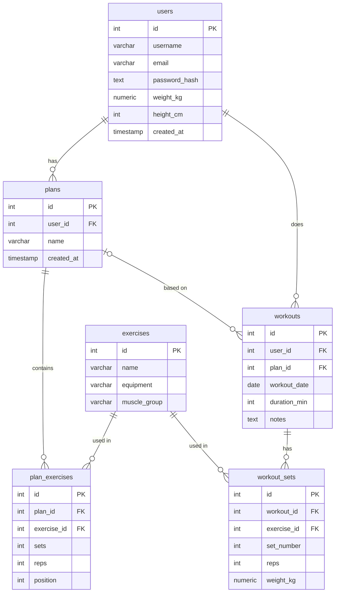

# Database design

Right now the app uses mock data (json files). This is the plan for the real database
when we add a backend. We are using PostgreSQL, see `db/` folder and `docker-compose.yml`.

Everything is kept simple, 6 tables.

## Tables

### users
People using the app. For now there is no login so there is just one test user.

| column | type | notes |
|---|---|---|
| id | serial | PK |
| username | varchar(50) | unique |
| email | varchar(100) | unique |
| password_hash | text | we will hash with bcrypt later |
| weight_kg | numeric(5,2) | for the profile tab |
| height_cm | integer | |
| created_at | timestamp | default now() |

### exercises
Catalog of exercises (Exercises tab). It is shared, every user sees the same list.
Equipment and muscle group are just text, no extra tables for that.

| column | type | notes |
|---|---|---|
| id | serial | PK |
| name | varchar(100) | e.g. "Przysiad ze sztangą" |
| equipment | varchar(50) | sztanga / hantle / maszyna / wyciag / masa ciala |
| muscle_group | varchar(50) | nogi / plecy / klatka / barki / biceps / triceps / brzuch |

### plans
One row = one card in the Workout tab (Day 1, Day 2, Day 4...). Belongs to a user.

| column | type | notes |
|---|---|---|
| id | serial | PK |
| user_id | integer | FK -> users, cascade delete |
| name | varchar(50) | |
| created_at | timestamp | |

### plan_exercises
Connects plans with exercises (many to many) and says how many sets/reps to do.
`position` is the order in the plan.

| column | type | notes |
|---|---|---|
| id | serial | PK |
| plan_id | integer | FK -> plans, cascade delete |
| exercise_id | integer | FK -> exercises |
| sets | integer | > 0 |
| reps | integer | > 0 |
| position | integer | unique inside one plan |

### workouts
One finished training. `plan_id` can be null, if the user deletes a plan we still
keep the workouts (ON DELETE SET NULL).

| column | type | notes |
|---|---|---|
| id | serial | PK |
| user_id | integer | FK -> users, cascade delete |
| plan_id | integer | FK -> plans, nullable |
| workout_date | date | |
| duration_min | integer | |
| notes | text | |

### workout_sets
Every single set done in a workout. The Raport tab is built from this table
(total weight, best set etc).

| column | type | notes |
|---|---|---|
| id | serial | PK |
| workout_id | integer | FK -> workouts, cascade delete |
| exercise_id | integer | FK -> exercises |
| set_number | integer | 1, 2, 3... |
| reps | integer | > 0 |
| weight_kg | numeric(5,2) | 0 for bodyweight exercises |

## Relations

- user has many plans and many workouts
- plan has many plan_exercises
- exercise can be in many plan_exercises and many workout_sets
- workout has many workout_sets
- workout optionally points to the plan it was based on

## Diagram

## How the tabs use it

- **Workout** - reads `plans` + `plan_exercises` (joined with `exercises` for the names)
- **Excersises** - reads `exercises`, filter by `muscle_group` / `equipment`
- **Raport** - sums `workout_sets` (reps * weight_kg) per workout / per week
- **Profile** - reads and updates `users`
